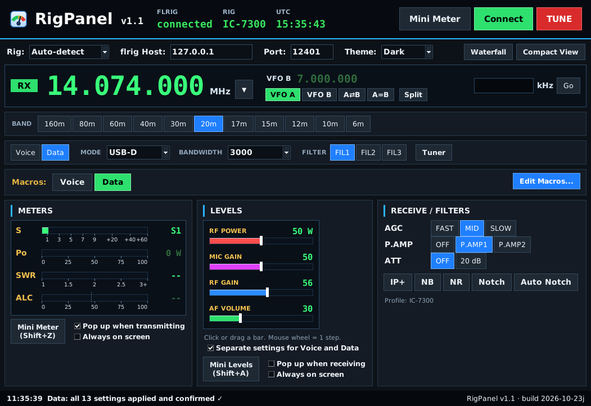
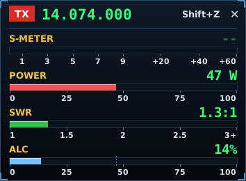
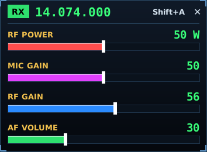

# RigPanel

A one-screen radio control panel that works **through [flrig](http://www.w1hkj.com/)**, so WSJT-X, JS8Call,
fldigi and your other digital apps keep sharing the radio. RigPanel never opens the radio's COM port.
Works with any radio flrig supports; full controls are built in for the **Icom IC-7300** and **Yaesu FT-891**.

**Version 1.4.3** - Windows 10/11 and Linux (Mint 21 / Ubuntu 22.04 or newer, Debian 12). Tested with flrig **2.0.09** and **2.0.12**.

**Download:** [Releases page](https://github.com/HamRadioMadeSimple/RigPanel/releases/latest)



## Features

- **Click-a-digit tuning**, bands, VFO A / B, A⇄B, A=B, split, RIT / CLAR, stored frequencies
  (green = Data, blue = Voice, red = CW).
- **Voice | Data | CW** in one row: each remembers its own width, levels, receive filters and frequency per band,
  and runs your **Rig Setting** of the same name (mode, width, menus) in one click.
- **Rig Settings**: one-click groups of radio settings, including every menu item of both radios
  (Edit Rig Settings: Common | All Menus, Read from radio, Save & Apply). ANTENNA buttons for tuner selection.
- **Meters** S / Po / SWR / ALC, **levels** RF Power / Mic / RF Gain / AF Volume + MUTE, RF gain per band.
- **Receive / filters**: AGC, preamp, ATT, NB, NR/DNR, notch, IC-7300 FIL1/2/3, passband SHIFT,
  FT-891 PROC, **BKIN OFF / SEMI / FULL** in CW (both radios).
- **VFO Scan** (FT-891): runs the radio's own scan inside your license's voice segment and lists where it stopped.
- Floating **Mini Meter** (Shift+Z) and **Mini Levels** with S-meter (Shift+L), Dark / Light
  themes, Shift hot keys.
- **Tap Ctrl** (on its own) in any program to bring RigPanel forward; tap again to minimize it (see below).
- Settings save to a file, copy to another PC and restore. Program updates never touch your settings.

| Mini meter | Mini Levels |
|---|---|
|  |  |

## Install

**Windows:** download `RigPanel_Setup_1.4.3.exe` from the [Releases page](https://github.com/HamRadioMadeSimple/RigPanel/releases/latest) and run it (no Python needed). The installer isn't
code-signed: if Windows says "Windows protected your PC", click **More info > Run anyway**.

**Linux:** save `RigPanel_Ver_1.4.3_Linux.tar.gz` from the [Releases page](https://github.com/HamRadioMadeSimple/RigPanel/releases/latest) in your **Downloads** folder, open a terminal
(Ctrl+Alt+T) and paste:

```
F="$(ls -t ~/Downloads/RigPanel_Ver_*_Linux.tar.gz | head -n 1)"
mkdir -p ~/Applications && tar -xzf "$F" -C ~/Applications
sh ~/Applications/"$(tar -tzf "$F" | head -n 1 | cut -d/ -f1)"/linux_install.sh
```

It installs into `~/Applications/RigPanel Ver 1.4.3` with a menu entry and a desktop icon. The same lines update
it. The ready-made Linux package runs on Linux Mint 21 / Ubuntu 22.04 or newer on 64-bit PCs; on anything else
(older Linux, Raspberry Pi) run from source (below). Prefer one file? `RigPanel-x86_64.AppImage` on the Releases page
runs without installing (make it executable, then double-click). Details:
[docs/RigPanel-Linux-Install.pdf](docs/RigPanel-Linux-Install.pdf).

Guides: [User Guide](docs/RigPanel_v1.4.3_User_Guide.pdf) · [Quick Start](docs/RigPanel_Quick_Start.pdf) ·
[Linux install](docs/RigPanel-Linux-Install.pdf).

## Works with your radio

| Radio | What you get |
|---|---|
| **IC-7300, FT-891** | Everything: receive filters, every menu item in Rig Settings, VFO Scan (FT-891) |
| **Other Icom / Yaesu** (IC-705, IC-7100, IC-7610, FT-710, FT-991A...) | Add it in **Settings ▾ > Add my radio**: it appears in the Rig list and gets the controls most of that brand share (AGC, preamp, ATT, NB, NR, notch, BKIN, CW width) plus Rig Settings for mode / width / filters |
| **Any other radio flrig supports** | Frequency, mode, bandwidth, VFOs, meters, levels and TUNE through flrig. Add it as *Other* to give it a name in the Rig list |

Added radios are community-tested: please report what works (see *Reporting problems*).

### Two station types - pick yours

Everyone uses flrig with the settings in the next section. The only difference is where the audio comes from:

| | Built-in sound card | External sound card (Digirig) |
|---|---|---|
| Radios | IC-7300, IC-705, IC-7100, IC-7610, FT-991A, FT-710... | FT-891, FT-857, FT-817, older radios without USB audio |
| Cables | One USB cable to the radio (CAT + audio) | Digirig: USB to the PC, cables to the radio's CAT and data jacks |
| flrig port | The radio's own USB serial port | The Digirig's serial port |
| Digital apps audio | The radio's **USB Audio CODEC** | The Digirig's audio device |
| PTT in WSJT-X / JS8Call | CAT (Rig: FLRig) | CAT (Rig: FLRig) |

RigPanel itself is set up the same way for both: it only talks to flrig.

## Set up flrig first

flrig must already work with your radio. Then, in **flrig > Config > Setup**:

| Page | Set |
|---|---|
| **Poll** | Meters: S-mtr, Pwr out, SWR, ALC. Operating Controls: **Freq, Mode, BW** (otherwise meters and bandwidth don't follow the radio) |
| **Restore** | Untick everything, tick only **Use xcvr data** (flrig then reads the radio at start-up instead of overwriting it) |
| **Server** | XML-RPC server on, port 12345 |

JS8Call / WSJT-X with an FT-891: Settings > Radio: PTT **CAT**, Mode **None**, Split **None**.
More flrig notes: `docs/FLRIG_COMPATIBILITY.md`.

## Tap Ctrl to bring RigPanel forward

A quick tap of **Ctrl on its own** (pressed and released, no other key) in any program brings RigPanel to the
front on its own monitor; another tap minimizes it. Ctrl+C, Ctrl+V and a held Ctrl do nothing. Works on Windows and
on Linux with X11 (not on Wayland).

To see that tap while another program is active, RigPanel checks **whether keys are up or down** about 60 times a
second. It never records, stores or sends which keys you press. Because a program that watches the keyboard can look
suspicious, some antivirus programs may question RigPanel; you can turn the tap off in **Settings ▾ > Tap Ctrl to
bring RigPanel forward**.

## Run from source

Python 3.9+ with Tk (Linux: `sudo apt install python3-tk`), nothing else. `requirements.txt` lists optional
packages for code that is still being worked on; RigPanel runs without them.

```
python -m rigpanel            # or RigPanel.bat (Windows) / ./rigpanel.sh (Linux)
```

No radio? Start the practice radio first: `python mock_flrig.py --rig IC-7300` (or `--rig FT-891`).

## Build the installers

The release files are built by GitHub (`.github/workflows/release.yml`, Linux on Ubuntu 22.04) when a version
tag is made. To build yourself:

- Windows: `build_windows.bat` (needs Python 3.9+ and [Inno Setup 6](https://jrsoftware.org/isdl.php))
  -> `output\RigPanel_Setup_1.4.3.exe`
- Linux: `bash build_linux.sh` (`--appimage` also makes the AppImage) -> `output/RigPanel_Ver_1.4.3_Linux.tar.gz`.
  Build on the oldest Linux you want it to run on.

## Layout

| Path | What |
|---|---|
| `rigpanel/` | The app: `core` (settings, look, helpers), `tables` (menu tables, band plan), `radios` (IC-7300 / FT-891 profiles), `worker` (the only code that talks to flrig), `widgets`, `waterfall`, `freqlist`, `minis`, `vscan` (VFO Scan), `extras`, `builder` (Edit Rig Settings), `app` (main window) |
| `mock_flrig.py` | Practice radio: a stand-in flrig for testing without hardware (`--real891` mimics flrig 2.0.09 + FT-891, `--flrig212` flrig 2.0.12) |
| `tests/` | `run_all.sh`: names check, whole-app regression and feature tests against the practice radio (needs a display; Xvfb on a server) |
| `tools/` | Radio diagnostic scripts (read-only unless the name says *write*, and those put everything back) - useful for bug reports |
| `examples/` | `KW3KW_settings.json`: a complete station (Rig Settings, frequencies, levels). Load with Settings > Load settings from a file (also on the Releases page) |
| `docs/` | User Guide, Quick Start and Linux install (PDF), architecture and flrig compatibility notes |

## Reporting problems

Open an issue on the [Issues page](https://github.com/HamRadioMadeSimple/RigPanel/issues). Include the build shown at the bottom right of the window,
your radio and flrig version (flrig > Help > About), and attach `rigpanel_debug.log` (click the build text to open
its folder). See [CONTRIBUTING.md](CONTRIBUTING.md).

## License

GPL-3.0 - see [LICENSE](LICENSE). Credits for other people's work: [NOTICE.md](NOTICE.md). Author: KW3KW.
